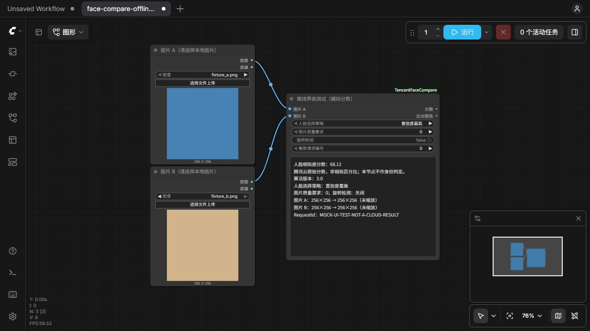

# 腾讯云人脸相似度 · ComfyUI

两个 IMAGE 输入，一次比对一对图片。节点内直接显示结果，并输出 `score`（FLOAT）与 `report`（STRING）。使用腾讯云 CompareFace / API 2020-03-03 / 模型 3.0，**通过 requests 直接调用 HTTPS API，不使用腾讯云 SDK**。

**图片会发送至腾讯云，调用按腾讯云账户服务规则计费。** 分数按腾讯云原值输出，不是相似百分比；节点不作身份判定。使用前请在腾讯云控制台开通人脸识别服务并准备有接口调用权限的密钥。

## 安装

适用于支持 `comfy_api.latest` V3 节点接口的 ComfyUI；开发验证环境为 ComfyUI 0.42.0、Python 3.12.10。插件不包含本地人脸模型，也不需要额外 GPU 推理。

1. 在 `ComfyUI/custom_nodes/` 中克隆本仓库，或者下载后将插件目录放入此位置：

```bash
git clone https://github.com/kevinzilin/ComfyUI-TencentFaceCompare.git
```

2. 使用运行 ComfyUI 的 Python 安装本目录 `requirements.txt`。Windows 便携版在整合包根目录执行 PowerShell：

```powershell
& '.\python_embeded\python.exe' -m pip install -r '.\ComfyUI\custom_nodes\ComfyUI-TencentFaceCompare\requirements.txt'
```

如果整合包提供 `python_embeded/pip_constraints.txt`，使用约束文件安装以保持该环境的依赖版本：

```powershell
& '.\python_embeded\python.exe' -m pip install --constraint '.\python_embeded\pip_constraints.txt' -r '.\ComfyUI\custom_nodes\ComfyUI-TencentFaceCompare\requirements.txt'
```

3. 将 `config.example.json` 复制为同目录的 `config.json`，用本地编辑器填写 `secret_id`、`secret_key`。不要将密钥发送至聊天或填入工作流。
4. 保存工作后，在自己的启动器中重启 ComfyUI，再刷新浏览器页面。搜索「腾讯云人脸相似度」或 `TencentFaceCompare`。

仅使用 ComfyUI 已有的 requests、Pillow、NumPy 和 torch；TC3-HMAC-SHA256 签名由 Python 标准库实现，无需安装腾讯云 SDK。实际 `config.json` 不纳入 Git 或分发包。插件本身不创建实际密钥文件，也不会自动读取其他应用的密钥。

## 配置

| 字段 | 内容 |
| --- | --- |
| `secret_id` | 腾讯云 SecretId，必填 |
| `secret_key` | 腾讯云 SecretKey，必填 |
| `region` | 默认 `ap-guangzhou` |
| `timeout_seconds` | 默认 30，允许 1—300 的整数秒数 |

地域可选 `ap-bangkok`、`ap-beijing`、`ap-chengdu`、`ap-chongqing`、`ap-guangzhou`、`ap-nanjing`、`ap-shanghai`、`ap-singapore`。本地配置以 UTF-8 JSON 保存，支持 Windows 编辑器 BOM。

配置缺失不影响插件加载；执行时会提示配置方法。修改并保存配置后，下次运行重新读取，通常不需要重启。配置采用本地明文文件，请保存在你控制的机器中，分享插件时仅分享配置模板。

## 使用

拖入 `examples/face_compare.json`，在两个「加载图像」节点分别选择图片，再运行。也可以连接工作流生成的 IMAGE。

| 参数/输出 | 说明 |
| --- | --- |
| 图片 A、图片 B | 每个输入必须只有一张图；批次大于 1 明确报错 |
| 人脸选择策略 | 默认「置信度最高」，可改「面积最大」；不支持点击指定某张脸 |
| 图片质量要求 | 0 不控制；1 较低；2 一般；3 较高；4 很高，默认 0 |
| 旋转检测 | 默认关闭；无 EXIF 且人脸被旋转时可以开启 |
| 重新请求编号 | 默认 0；修改后对相同图片重新请求，例如错误重试时从 0 改为 1 |
| 分数 | FLOAT，原始精度，不四舍五入，不转为百分比 |
| 比对报告 | STRING；包含显示分数（两位小数）、模型、策略、处理尺寸及 RequestId |

无需连接下游也能执行。输入不变时使用 ComfyUI 缓存；节点输入、配置文件元数据或重新请求编号变化后重新执行。配置缓存检测基于修改时间、创建时间和文件大小；如用工具保留原时间戳覆盖配置，可修改重新请求编号强制刷新。关闭 ComfyUI 缓存时以主程序行为为准。插件不自动重试，单次节点执行最多发起一次 CompareFace 请求。

多人图由接口按策略选脸，报告不会显示人脸框。若需要比较指定人物，请在上游裁剪，并保留完整人脸。两张图片无需同尺寸。

以下截图使用离线模拟响应，仅展示节点界面，分数不代表腾讯云真实识别结果：



## 图片处理与错误

RGB 直接编码；灰度扩展为 RGB；RGBA 在白底合成。仅在内存转换为 JPEG（质量 95），不改变上游张量、不额外保存上传副本。长边超过 4000 时等比例缩小；Base64 超过 5,000,000 字节时按每轮 85% 缩小。短边原本或缩小后不足 64 像素时拒绝请求。报告注明原始/提交尺寸和是否缩放。

无人脸、质量不合格、鉴权失败、余额不足、未开通服务、限流和超时会报中文错误；可用时保留错误码与 RequestId。报错不输出伪造的 0 分。执行开始、失败或中断时清除节点内旧分数。密钥、签名、图片 Base64 和服务端原始错误正文不进入报告或插件日志。

## 测试

从整合包根目录运行：

```powershell
& '.\python_embeded\python.exe' '.\ComfyUI\custom_nodes\ComfyUI-TencentFaceCompare\tests\test_plugin.py'
node '.\ComfyUI\custom_nodes\ComfyUI-TencentFaceCompare\tests\test_frontend.mjs'
```

Python 测试使用真实 ComfyUI 类型，模拟 HTTP 响应，不读取真实配置、不调用付费接口。覆盖官方签名规范请求向量、固定签名测试向量、UTC 日期、实际发送与签名正文一致、图片处理、请求字段、无重试、不跟随重定向、错误脱敏、输出精度和节点注册。JavaScript 测试覆盖显示与旧分数清除。

`tests/run_ui_fixture.py` 可启动 8199 端口的隔离 CPU 测试实例，使用临时目录中的插件副本和虚拟密钥，所有 CompareFace 调用均为模拟。打开工作流侧栏中的 `face-compare-offline-test` 运行，质量要求设为 4 可模拟无人脸失败。结束测试按 Ctrl+C；该实例不会重启或切换启动器当前环境。

真实接口验收需自行在本地配置密钥后，用同人不同照片、不同人照片、无人脸图片分别运行。离线模拟分数不代表腾讯云识别效果。

## 官方资料

- [CompareFace 接口文档](https://cloud.tencent.com/document/product/867/44987)
- [腾讯云 TC3-HMAC-SHA256 签名文档](https://cloud.tencent.com/document/api/213/30654)
